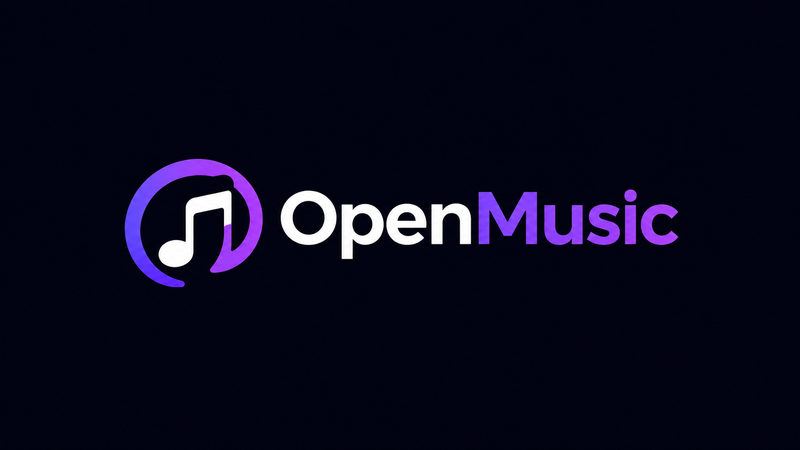
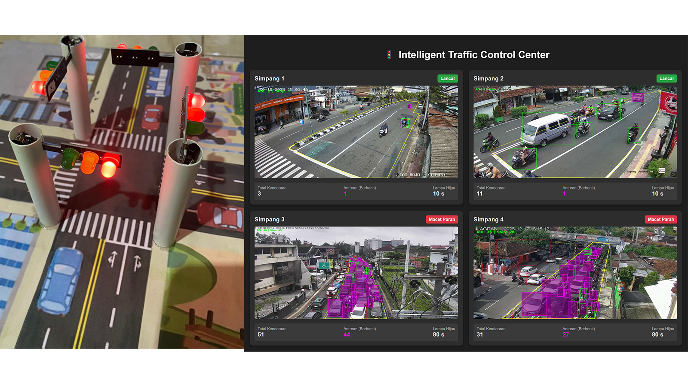

<!-- 01 · HERO -->

  

  
   
   
  

  

<!-- 02 · ABOUT -->
<h2 id="hi-there">👋 Hi There!</h2>

<table>
  <tr>
    <td width="62%" valign="middle">
      
I'm <strong>Nur Saifuddin</strong>, an Informatics Engineering graduate focused on <strong>Backend Development</strong>.

      
I build server-side applications and RESTful APIs using JavaScript and the Node.js ecosystem, primarily with Express.js and Hapi.js. My work includes database-driven features, authentication and authorization, API integration, testing, and technical documentation.

      
I also bring supporting capabilities in cloud infrastructure and deployment practices, including Google Cloud Platform, Docker, and CI/CD workflows. I enjoy turning practical requirements into maintainable backend services with clear interfaces and dependable data flows.

    </td>
    <td width="38%" valign="middle" align="center">
      
    </td>
  </tr>
</table>

  
  &nbsp;
  
  &nbsp;
  
  &nbsp;
  

  

<!-- 03 · TECH STACK -->
<h2 id="tech-stack--technical-expertise">🧰 Tech Stack &amp; Technical Expertise</h2>

A focused overview of the core languages, backend tools, data platforms, quality practices, and infrastructure I have applied across projects and training.

  A focused overview of the technologies, frameworks, development tools, data platforms, and infrastructure I have applied across backend projects, cloud deployments, and technical training.

<table>
  <tr>
    <td width="100%" valign="top">
      <h3>💻 Languages</h3>
      

        
        
        
      

    </td>
  </tr>

  <tr>
    <td width="100%" valign="top">
      <h3>⚙️ Backend & Runtime</h3>
      

        
        
        
        
        
        
        
        
        
        
      

    </td>
  </tr>

  <tr>
    <td width="100%" valign="top">
      <h3>🗄️ Data & Messaging</h3>
      

        
        
        
        
        
        
        
        
      

    </td>
  </tr>

  <tr>
    <td width="100%" valign="top">
      <h3>🔐 Security & Quality</h3>
      

        
        
        
        
        
        
        
        
        
        
      

    </td>
  </tr>

  <tr>
    <td width="100%" valign="top">
      <h3>👁️ Artificial Intelligence & IoT</h3>
      

        
        
        
        
        
        
      

    </td>
  </tr>

  <tr>
    <td width="100%" valign="top">
      <h3>☁️ Cloud & DevOps</h3>
      

        
        
        
        
        
        
        
        
        
        
        
        
        
        
        
        
        
        
        
      

    </td>
  </tr>
</table>

Project-specific technologies are listed separately in each project. This section summarizes the core tools and platforms I have worked with across projects, internship, and structured learning.

  

<!-- 04 · PROJECTS -->
<h2 id="featured-projects">🚀 Featured Projects</h2>

Selected work across backend API engineering, cloud-connected applications, and intelligent traffic systems.

<table>
  <tr>
    <td width="50%" valign="top">
      
      <h3>🎵 OpenMusic-API</h3>
      
A backend service for a music platform where users can browse and manage albums and songs, create playlists, collaborate with other users, and follow playlist activity. It also handles playlist exports in the background and sends the completed files by email.

      
<strong>Technology stack</strong>

      

        
        
        
        
        
        
        
        
        
        
        
        
        
        
        
        
        
        
        
        
        
        
        
        
        
      

      
<a href="https://github.com/nsaifuddin/OpenMusic-API"><strong>↗ Explore Repository</strong></a>

    </td>
    <td width="50%" valign="top">
      
      <h3>💙 FixU-Cloud-Computing</h3>
      
The backend of a mental-wellness application that manages user sign-in and screening submissions. It sends responses to an AI service for analysis, stores users’ results and personal notes, and delivers supportive quote images from cloud storage.

      
<strong>Technology stack</strong>

      

        
        
        
        
        
        
        
        
        
        
        
        
        
        
        
        
        
        
        
        
        
      

      
<a href="https://github.com/nsaifuddin/FixU-Cloud-Computing"><strong>↗ Explore Repository</strong></a>

    </td>
  </tr>
  <tr>
    <td colspan="2" valign="top">
      
      <h3>🚦 Adaptive Intelligent Traffic Control System</h3>
      
A smart traffic-light prototype that analyzes camera feeds to detect and count vehicles, estimate queue lengths, and adjust signal timing based on traffic conditions. A web dashboard displays the monitoring results, while an ESP32 controls a miniature traffic-light model to demonstrate the system in action.

      
<strong>Technology stack</strong>

      

        
        
        
        
        
        
        
        
        
        
        
        
        
        
        
        
        
        
        
        
        
        
        
        
        
        
        
        
      

      
<a href="https://github.com/nsaifuddin/Adaptive-Intelligent-Traffic-Control-System"><strong>↗ Explore Repository</strong></a>

    </td>
  </tr>
</table>

  

<!-- 05 · ENGINEERING FOCUS -->
<h2 id="engineering-focus">🧠 Engineering Focus</h2>

Six areas that guide how I design, build, secure, deploy, and maintain backend systems.

<table>
  <tr>
    <td width="76" align="center" valign="middle">
      
    </td>
    <td valign="middle">
      <strong>01 · Backend Architecture &amp; API Development</strong> 
      Designing modular server-side components, clear REST endpoints, and consistent request and response contracts.
    </td>
  </tr>
  <tr>
    <td width="76" align="center" valign="middle">
      
    </td>
    <td valign="middle">
      <strong>02 · Database Design &amp; Management</strong> 
      Structuring data, choosing suitable storage, and building reliable queries, relationships, and data flows.
    </td>
  </tr>
  <tr>
    <td width="76" align="center" valign="middle">
      
    </td>
    <td valign="middle">
      <strong>03 · Application Security</strong> 
      Applying authentication, authorization, input validation, and secure handling of application data.
    </td>
  </tr>
  <tr>
    <td width="76" align="center" valign="middle">
      
    </td>
    <td valign="middle">
      <strong>04 · Quality &amp; Documentation</strong> 
      Testing application flows and documenting APIs to make services easier to understand and maintain.
    </td>
  </tr>
  <tr>
    <td width="76" align="center" valign="middle">
      
    </td>
    <td valign="middle">
      <strong>05 · Cloud Infrastructure &amp; Deployment</strong> 
      Packaging backend services and supporting repeatable deployments through cloud platforms, containers, and CI/CD.
    </td>
  </tr>
  <tr>
    <td width="76" align="center" valign="middle">
      
    </td>
    <td valign="middle">
      <strong>06 · Backend Reliability</strong> 
      Building dependable services with structured error handling, logging, monitoring, and maintainable workflows.
    </td>
  </tr>
</table>

  

<!-- 06 · ANALYTICS -->
 

  

  

<!-- 07 · CONNECT -->
<h2 id="lets-connect">🤝 Let's Connect</h2>

I'm open to connecting with developers, exchanging ideas, collaborating on meaningful projects, and discussing opportunities in <strong>Backend Development</strong>.

   
  
  
  
  
   

  

<!-- 08 · FOOTER -->

  
  <h3>Thanks for visiting my profile! 👋</h3>
  
<strong>Keep Building · Keep Learning · Keep Improving</strong>

